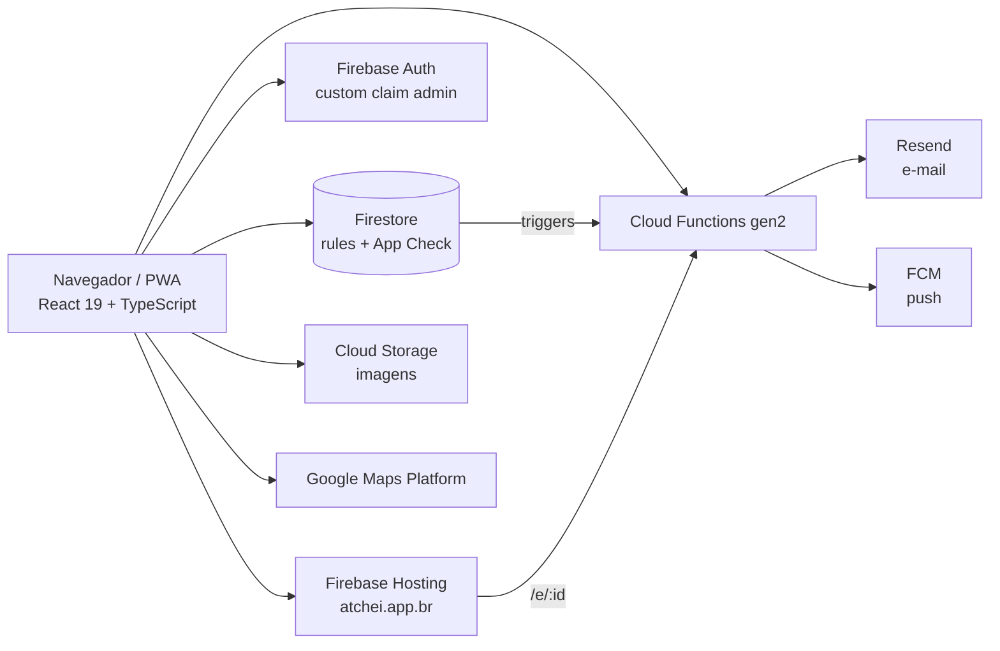

# Atchei - Plataforma de Eventos 🎟️

**Atchei** é uma plataforma para criar e descobrir eventos de qualquer tipo — de festas, shows e festivais a um racha de vôlei, um encontro cultural ou um evento gastronômico. Qualquer pessoa logada cria um evento em minutos e escolhe como ele funciona: **presença gratuita** (só juntar gente) e/ou **venda por WhatsApp** (contato direto com os promoters) — os modos são combináveis. A presença confirmada é um RSVP social: conta no evento e entra na lista de inscritos, mas **não emite ingresso**. Para quem vende, o ciclo se fecha na portaria: o ingresso é validado por QR Code.

Produção: **https://atchei.app.br** · PWA instalável · Documentação completa em [docs/DOCUMENTACAO.md](docs/DOCUMENTACAO.md)

---

## Destaques de engenharia

- **Sem servidor próprio.** O cliente fala direto com o Firestore; as security rules (344 linhas) são a camada de autorização. Cloud Functions só entram onde há privilégio, segredo, reação a escrita ou cron.
- **Contadores são do backend.** Totais de inscrições e de ingressos são escritos apenas por triggers; as rules bloqueiam a escrita pelo cliente.
- **Testes como rotina.** 138 casos em 27 arquivos (Vitest e Testing Library no frontend, Vitest nas functions), sem nunca tocar o Firebase real.
- **Três pipelines no GitHub Actions.** CI em todo pull request, deploy a cada merge e auditoria diária com build, testes, `npm audit`, higiene de segurança e smoke de produção.
- **Segurança em camadas.** Admin por custom claim, App Check com reCAPTCHA v3, rate limiter que falha fechado nas rotas de e-mail, HSTS, CSV protegido contra injeção de fórmula.
- **Performance medida.** Fonte local, autenticação sem iframe, Analytics após o `load`, capas em WebP com `fetchpriority` na primeira e lazy nas demais.
- **Desenvolvimento com agentes de IA, supervisionado.** O `CLAUDE.md` do repositório dá o contexto do projeto aos agentes; planejamento, implementação, revisão e testes passam por revisão humana em pull request.

### Arquitetura



### Decisões e trade-offs

| Decisão | Por quê |
|---|---|
| Pagamento Pix in-app removido; venda por WhatsApp | Reduzir escopo e risco antes do lançamento. Se voltar, será implementação nova. |
| Permanecer no Firebase em vez de migrar para Postgres | Uso real medido e projeção de custo mostraram Firebase mais barato nas escalas realistas. Gatilhos de revisão estão documentados. |
| QR do ingresso gerado no aparelho | O serviço externo recebia o id da inscrição, que é a credencial da portaria, e era ponto de falha offline. |
| Modal sobre o `<dialog>` nativo | Foco preso, fundo inerte e Escape resolvidos pelo navegador, com menos código próprio. |
| Saída de zod e react-hook-form | Auditoria de over-engineering: validação nativa e `useState` bastavam para o formulário. |
| App Check ligado mesmo custando nota no PageSpeed | Proteção contra bot pesa mais que os pontos perdidos; decisão registrada com a medição. |

O histórico completo, com datas, está em [docs/DOCUMENTACAO.md](docs/DOCUMENTACAO.md#13-decisões-e-histórico).

### Próximos passos

- **Backup semanal criptografado fora do Google.** O workflow (`backup-semanal.yml`) já existe e foi validado, mas está desligado desde que este repositório ficou público: os artefatos passariam a ser visíveis. Volta a rodar quando o destino for um repositório privado.

---

## ✨ Funcionalidades

**Para o público**
- Feed paginado de eventos vigentes, com filtros de tempo (Em alta, Hoje, Esta semana), busca e categorias (Festa, Universitário, Show, Esporte, Gastronomia, Cultural, Outros)
- Confirmação de **presença gratuita** em eventos que permitem — RSVP em 1 toque, sem emitir ingresso
- **Intenção de compra via WhatsApp**: o comprador entra na lista do vendedor como "Aguardando pagamento" e o vendedor confirma
- Ingresso com QR Code, exportável como imagem
- Página do evento com mapa, rota no Google Maps e "adicionar ao Google Agenda"; link compartilhável com preview Open Graph
- **PWA instalável** com notificações push (lembrete D-1 automático)

**Para organizadores** (qualquer conta logada)
- Criação e edição dos próprios eventos: data/hora, local com Google Places, capa com recorte, capacidade máxima, modos de participação
- Lista de inscritos com confirmação de pagamento WhatsApp, inscrições manuais (cortesia, dinheiro, PIX manual) e exportação
- Scanner de portaria em tela cheia, com troca de câmera, código curto digitável e feedback por vibração

**Para admin**
- Painel de controle: gestão irrestrita de eventos e perfis
- Criação de parceiros com senha temporária e troca obrigatória no primeiro acesso
- **Exclusão completa de conta** (login + perfil + eventos + inscrições + tokens) em uma ação
- Geração de ingressos de teste sem afetar contagens reais

---

## 👥 Papéis

| Papel | O que pode fazer |
|---|---|
| **Visitante** | Ver feed, busca e detalhes de eventos |
| **Pessoal** (`user`) | Tudo acima + perfil, presença gratuita, intenção de compra, meus ingressos, push; criar/editar/excluir **os próprios** eventos; validar ingressos dos próprios eventos; inscrições manuais |
| **Profissional** (`profissional`) | Tudo acima + aparece no diretório público de organizadores da busca |
| **Admin** | Acesso irrestrito, incluindo CRUD de perfis, exclusão completa de contas e ingressos de teste |

Os tipos legados `atletica` e `estabelecimento` foram fundidos em `profissional` (documentos antigos continuam valendo). O **registro público está aberto** (tipos `user` e `profissional`) com exigência de **18+** validada também nas security rules. Autorização de admin é **100% via custom claim** do Firebase Auth (`admin: true`) — o papel de admin *na interface* vem do perfil com `type: 'admin'`; os dois são independentes e uma conta admin precisa dos dois.

---

## 🛠️ Stack

**Frontend** — React 19 · Vite 8 · TypeScript · Tailwind 3 · React Router 7 · Lucide
`@vis.gl/react-google-maps` (Places) · `qrcode` (QR do ingresso, gerado no aparelho) · `@zxing/browser` (leitura de QR) · `react-easy-crop` · `html-to-image` · `react-hot-toast` · `vite-plugin-pwa`

**Backend** — Firebase: Authentication · Firestore · Cloud Storage · Cloud Functions gen2 (Node 22) · Cloud Messaging · App Check (reCAPTCHA v3) · Hosting · Analytics
E-mail transacional via **Resend** (API HTTP, sem SDK). Google Maps Platform (Embed, JavaScript e Places).

**Testes** — Vitest + Testing Library + jsdom no frontend; Vitest nas functions.

**Identidade visual** — tema claro, âmbar `#FFB34D` e preto sobre off-white `#FFFCF8`, tipografia Plus Jakarta Sans (ver `tailwind.config.js`).

---

## 💳 Pagamento

Não há pagamento dentro da plataforma. A venda de ingressos acontece por **WhatsApp**, em contato direto com os promoters cadastrados no evento: o comprador registra a intenção pelo app, o vendedor confirma o pagamento no painel de inscritos e só então o registro vira ingresso. Pagamentos em dinheiro/PIX manual/cortesia entram por inscrição manual do organizador.

> A integração Pix (Asaas) que existiu no projeto foi **removida do código em 2026-08-31**. Se pagamento in-app voltar, será uma implementação nova — ver [docs/DOCUMENTACAO.md](docs/DOCUMENTACAO.md#13-decisões-e-histórico).

---

## 🎫 Validação na portaria

O scanner aceita duas entradas:

- **QR Code** — o id completo do documento de inscrição
- **Código curto** — formato `ATX-XXXX-XXXX`, para digitar quando a câmera falha (prefixo legado `CHN-` continua aceito)

O código curto é derivado do id por FNV-1a → base32 Crockford, sem campo extra no banco. Se mais de uma inscrição casar com o mesmo código, o sistema **recusa a validação**. Check-ins não podem ser revertidos. Só ingresso de verdade passa: intenção de compra ainda não confirmada e confirmação de presença gratuita são recusadas pelo scanner.

---

## 🔧 Rodando localmente

**Pré-requisitos:** Node 22+ e acesso ao projeto Firebase.

```bash
npm install
cd functions && npm install && cd ..
```

Crie um `.env` na raiz (veja `.env.example`) — todas as chaves são **públicas** (config do Firebase, site key do reCAPTCHA, chave de browser do Maps restrita por referrer):

```env
VITE_GOOGLE_MAPS_API_KEY=
VITE_RECAPTCHA_SITE_KEY=     # App Check; sem ela o App Check fica desativado no cliente
VITE_FIREBASE_API_KEY=
VITE_FIREBASE_AUTH_DOMAIN=
VITE_FIREBASE_PROJECT_ID=
VITE_FIREBASE_STORAGE_BUCKET=
VITE_FIREBASE_MESSAGING_SENDER_ID=
VITE_FIREBASE_APP_ID=
VITE_FIREBASE_MEASUREMENT_ID=
VITE_FIREBASE_VAPID_KEY=     # opcional — sem ela, push fica desativado
```

E um `.env.local` (gitignorado) com o token de depuração do App Check da sua máquina, registrado uma vez no console (Firebase → App Check → Apps → tokens de depuração):

```env
VITE_APPCHECK_DEBUG_TOKEN=
```

Para as functions, um `functions/.env` (veja `functions/.env.example`): `APP_BASE_URL`, `RESEND_API_KEY`, `EMAIL_FROM`. Em produção esses dois últimos vêm do **Secret Manager**, não do `.env`.

> **Não existe backend de desenvolvimento.** O `npm run dev` fala com o **mesmo projeto Firebase da produção** — qualquer dado que você mexer no localhost é mexida real.

```bash
npm run dev          # Vite em http://localhost:5173
npm run build        # tsc -b && vite build
npm run lint
npm run test:run     # suíte usada no CI
cd functions && npm test
```

---

## 🚢 CI e deploy

Convenção do projeto: todo trabalho entra na `main` por Pull Request — nada de push direto.

1. **CI** (`.github/workflows/ci.yml`) — em todo PR para `main`: build + testes do frontend e das functions.
2. **Deploy** (`.github/workflows/deploy.yml`) — no push para `main` (a cada merge): repete os testes, builda e publica no Firebase (hosting + rules + functions). Um deploy por vez, sem cancelar o anterior.

Secrets do repositório: `VITE_ENV` (conteúdo completo do `.env` do frontend) e `FIREBASE_SERVICE_ACCOUNT` (JSON da service account do deploy). O `.env` **nunca** vai para o git.

> Function **nova** não sobe pelo CI na primeira vez (a service account não consegue criá-la). Receita em [docs/DOCUMENTACAO.md](docs/DOCUMENTACAO.md#11-operações-runbooks).

---

## 📁 Estrutura

```
src/
  pages/         telas (Feed, EventDetails, Profile, AdminDashboard, ValidateTickets, ...)
  components/    componentes por domínio (Admin, CreateEvent, EventDetails, Profile, ui)
  contexts/      AuthContext (sessão + role)
  hooks/         useRateLimit, useEscapeToClose, useInstallCardPending
  lib/           firebase (init, App Check, Analytics), notifications (FCM), formatters,
                 ticketCode, imageUtils, storageKeys, utils
  lib/storage/   fachada de dados: auth, profiles, events, registrations, files, types
  test/          setup do Vitest e mocks do Firebase
functions/
  index.js       callables, triggers do Firestore, cron e OG preview
  email.js       e-mail transacional (Resend)
  reminders.js   lembretes D-1 por push
  ogPreview.js   página Open Graph para links compartilhados (/e/:id)
  rateLimiter.js rate limiting transacional no Firestore
  adminEmails.js lista de e-mails que recebem o claim de admin
  scripts/       set-admins.js, set-user-password.js
firebase/        firestore.rules e storage.rules
docs/            DOCUMENTACAO.md (arquitetura completa) e identidade-visual.md
```

---

## 📄 Licença

Software proprietário. Todos os direitos reservados — veja [LICENSE](LICENSE).
