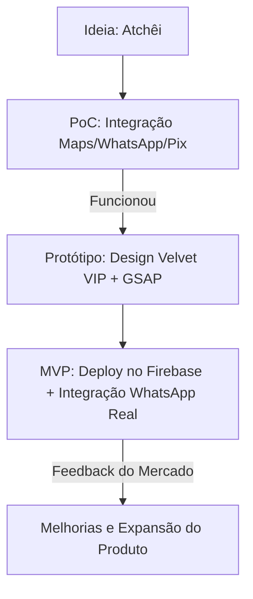

# Trabalho Acadêmico: PoC, Protótipo e MVP do Projeto Atchêi 🎬
**Disciplina:** Empreendedorismo e Inovação Tecnológica (EIT)  
**Projeto:** Atchêi - Plataforma de Eventos Cinematográfica

---

## 1. Introdução ao Projeto Atchêi
O **Atchêi** é uma plataforma digital voltada para a gestão, divulgação e descoberta de eventos, festivais, clubes e atléticas. Focado na estética "Velvet VIP" e na experiência de usuário (UX) de alta fidelidade, o projeto visa conectar organizadores de eventos e clientes finais de maneira otimizada. 

Para estruturar e validar a viabilidade técnica e mercadológica da plataforma, o desenvolvimento seguiu os conceitos de **PoC (Prova de Conceito)**, **Protótipo** e **MVP (Mínimo Produto Viável)** descritos na metodologia da disciplina de Empreendedorismo e Inovação Tecnológica.

---

## 2. Prova de Conceito (PoC)

### 2.1. O que é?
Conforme o material de EIT, a **PoC (Proof of Concept)** é um processo que verifica se a concretização de determinada ideia é realmente viável ou não. Ela busca provar a ideia geral ou a tecnologia de forma teórica ou por meio de experimentação de baixo nível técnico.

### 2.2. Aplicação no Atchêi
A PoC do Atchêi foi elaborada para validar dois componentes tecnológicos cruciais para a proposta de valor do negócio:

1. **Viabilidade de Geolocalização (Google Maps API):** Testar a integração com a API do Google Maps para verificar se era viável traçar rotas e exibir estabelecimentos em tempo real em um ambiente web híbrido.
2. **Integração de Contatos via WhatsApp:** Validar se a geração automatizada de links dinâmicos para conversas no WhatsApp funcionaria como canal principal de reservas de lounges/mesas e conversão de ingressos, sem a necessidade de construir um gateway de pagamento complexo inicialmente.
3. **Fluxo Pix Simulado (Pix Server):** Testar se a comunicação para geração de QR Codes Pix estáticos/dinâmicos funcionava corretamente em background.

---

## 3. Protótipo

### 3.1. O que é?
O **Protótipo** é uma amostra preliminar do produto real para validar ideias, design, usabilidade e fluxos de interação. Diferente da PoC, o protótipo visa demonstrar na prática o funcionamento e usabilidade do produto, permitindo testes de interação.

### 3.2. Aplicação no Atchêi
O protótipo do Atchêi evoluiu de esboços estruturais para um **Protótipo Digital de Alta Fidelidade**:
* **Aparência VIP (Interface e Estilo):** Desenvolvimento do tema escuro com tons dourados (#D4AF37), tipografia refinada e animações suaves usando a biblioteca **GSAP (GreenSock Animation Platform)** para simular o "efeito cinema" e causar o sentimento de exclusividade (Fomo).
* **Fluxo de Navegação Simulado:** Criação de telas completas do Feed, Detalhes de Eventos, Perfil do Usuário e Dashboard do Administrador para testar a experiência do usuário (usabilidade) antes de finalizar a integração com o banco de dados dinâmico.

---

## 4. Mínimo Produto Viável (MVP)

### 4.1. O que é?
O **MVP (Minimum Viable Product)** é a versão mais simples e funcional de um produto, contendo apenas os requisitos essenciais, lançada no mercado real para validar a aceitação comercial e coletar feedbacks valiosos de clientes reais.

### 4.2. Aplicação no Atchêi
O MVP do Atchêi foi implementado e disponibilizado de forma funcional em: **[atche-sistemas.web.app](https://atche-sistemas.web.app/)**

**Características do MVP:**
* **Área do Parceiro Simplificada:** Permite que organizadores de eventos cadastrem e gerenciem seus eventos de forma básica.
* **Feed Funcional:** Usuários conseguem filtrar eventos ativos ("Aberto", "VIP", "Hoje", "Esta Semana").
* **Validação Comercial:** Ao invés de criar um sistema complexo de cobrança próprio (que aumentaria os custos e o tempo de desenvolvimento), o MVP direciona o usuário final diretamente para o WhatsApp do organizador para reservas de lounges e compra de ingressos.
* **Foco no Essencial:** Seguindo o conceito de *Earliest Usable & Lovable*, o MVP entrega valor imediato para os parceiros (divulgação e captação de leads) e para os usuários (descoberta de eventos), com baixíssimo custo operacional.

---

## 5. Ciclo de Validação e Conclusão

### 5.1. O Dilema da Excelência Operacional
Ao lançar o MVP diretamente no Firebase, o Atchêi evitou o erro do "Lançamento Big Bang" (tentar fazer um sistema perfeito com banco de dados massivo e processamento completo de pagamentos antes de saber se as pessoas usariam). 

A plataforma foi lançada de forma **suficiente** e **atrativa** para obter feedback real imediatamente, mantendo o custo de desenvolvimento baixo e o foco na experiência visual e no engajamento dos parceiros e usuários.
